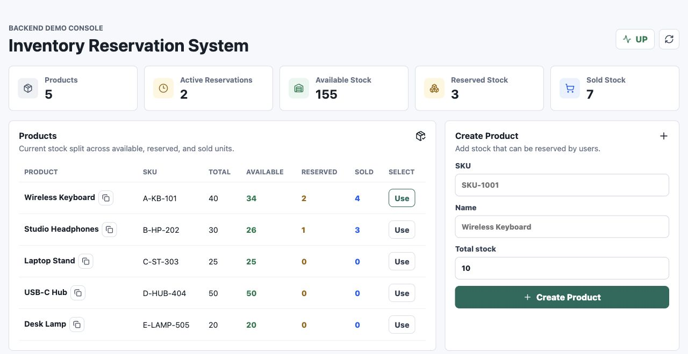
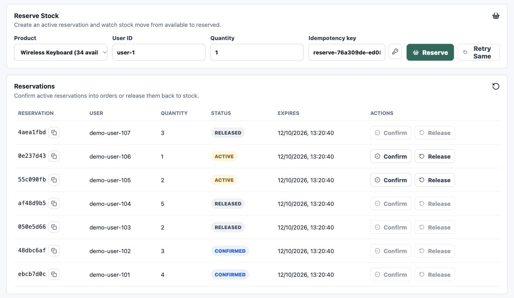
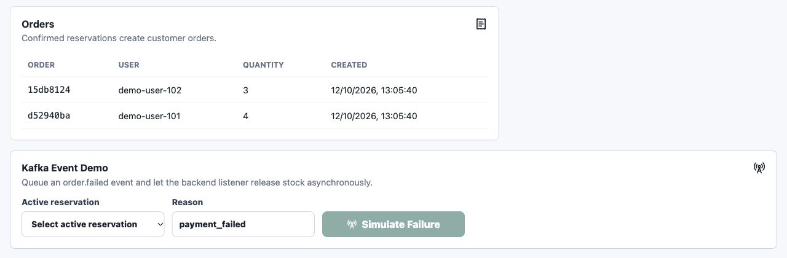
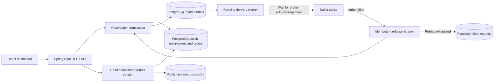

<div align="center">

# Inventory Reservation System

**Reserve stock safely. Confirm orders once. Recover when services fail.**

A Spring Boot backend and React demo console for concurrent inventory reservations,
with PostgreSQL transactions, Redis snapshots, and durable Kafka delivery.

[](https://github.com/Archit-k20/Inventory-Reservation-System/actions/workflows/checks.yml)


[Quick start](#quick-start) · [Screenshots](#screenshots) · [How it works](#how-it-works) · [API](#api-reference) · [Tests](#verification) · [Troubleshooting](#operations-and-troubleshooting)

</div>



## About the project

An inventory system becomes interesting when requests overlap: two customers want the last item, a client retries after a timeout, a reservation expires during checkout, or payment fails while Kafka is unavailable. This project demonstrates how to keep stock consistent through those workflows.

The dashboard exposes the existing backend in one screen: products, product creation, reservations, confirmation and release, orders, and a Kafka failure simulation. It uses real API responses; a failed request never becomes fabricated demo data.

This is a **local engineering demonstration**, with a tested reservation workflow. It has no authentication or authorization and is not ready for public production exposure. The supplied Docker ports bind to `127.0.0.1`.

## Screenshots

Captured from the running application with local demonstration records. A fresh installation starts empty; the pictured products and orders are not preloaded. Tables scroll horizontally on narrow screens.

| Reservations and stock transitions | Orders and asynchronous failure demo |
| --- | --- |
| [](docs/screenshots/03-reservations.jpg) | [](docs/screenshots/04-orders-kafka.jpg) |

[Full desktop dashboard](docs/screenshots/02-full-dashboard.jpg) · [Verified Kafka release](docs/screenshots/05-kafka-release.jpg) · [Mobile dashboard](docs/screenshots/06-mobile.jpg) · [All screenshot files](docs/screenshots)

## Quick start

### Requirements

- Git
- Docker Engine with Docker Compose v2, or Docker Desktop, running with Linux containers
- Node.js **24 LTS recommended**; supported versions are **22.13+ within Node 22**, **24.x**, or **26+**
- Java **17+** only if running the backend outside Docker

The Maven Wrapper is included. A separate Maven installation is unnecessary.

### 1. Clone and configure

```bash
git clone https://github.com/Archit-k20/Inventory-Reservation-System.git
cd Inventory-Reservation-System
cp .env.example .env
```

On PowerShell, use `Copy-Item .env.example .env`. The defaults are for local development. If a port is already occupied, change it in `.env` before starting.

### 2. Start the complete backend

```bash
docker compose --profile app up --build -d
docker compose --profile app ps
```

This builds the Java application and starts the API, PostgreSQL, Redis, and Kafka. The first build downloads dependencies and images. Wait for the API container to become healthy:

```bash
curl http://localhost:8080/actuator/health
```

Expected when all dependencies are available:

```json
{"status":"UP"}
```

Flyway automatically creates and migrates the database. No manual database creation, SQL import, topic creation, or seed step is required. Existing V1/V2 databases receive the additive V3 event-delivery tables; their product, reservation, and order rows are preserved.

### 3. Start the frontend in a second terminal

From the repository root:

```bash
cd frontend
cp .env.example .env.local
npm ci
npm run dev
```

Open **[localhost:5173](http://localhost:5173)**. If you changed `API_PORT`, update `VITE_API_BASE_URL` in `frontend/.env.local` and restart Vite. The dev server refuses an occupied port instead of silently moving to an origin the API does not allow.

### 4. Try the complete workflow

1. Create a product, such as `KEYBOARD-001`, with 10 units.
2. Reserve 2 units. Available becomes 8; reserved becomes 2.
3. Click **Retry Same** without changing the request or key. It returns the same reservation and does not deduct stock again.
4. Confirm that reservation. Reserved becomes 0; sold becomes 2; an order appears.
5. Create another reservation with a **new idempotency key**. Release it manually, or select it in **Kafka Event Demo** and click **Simulate Failure**.
6. Watch the reservation become `RELEASED` and available stock increase. The interface distinguishes an accepted event from a completed release.

Unconfirmed reservations expire after 15 minutes. The expiry job runs every 30 seconds in batches of 100. Use Refresh to retrieve changes made outside the dashboard.

### Local endpoints

| Service | Default address | Purpose |
| --- | --- | --- |
| Dashboard | `http://localhost:5173` | React demo console |
| API | `http://localhost:8080` | Products, reservations, orders |
| Swagger UI | `http://localhost:8080/swagger-ui.html` | Interactive API documentation |
| Health | `http://localhost:8080/actuator/health` | Database, Redis, Kafka and application checks |
| Prometheus | `http://localhost:8080/actuator/prometheus` | Metrics endpoint; no Prometheus server is bundled |
| PostgreSQL | `localhost:5433` | Database `inventory_db` |
| Redis | `localhost:6379` | Optional product snapshot cache |
| Kafka | `localhost:9092` | Host client listener; containers use `kafka:9093` |

## Run the backend with Java instead

Use this when developing the Java code directly. Do not also run the Docker API on the same port.

```bash
# From the repository root; starts PostgreSQL, Redis and Kafka only
docker compose up --build -d
./mvnw spring-boot:run
```

On Windows:

```powershell
.\mvnw.cmd spring-boot:run
```

If switching from the complete Docker setup, stop its API first with `docker compose --profile app stop api`.

Spring Boot's defaults match the default Compose ports and credentials. The root `.env` is read by **Docker Compose**, not automatically by Java. Export matching variables when using custom ports or credentials, for example:

```bash
DATABASE_URL=jdbc:postgresql://localhost:5543/inventory_db \
REDIS_PORT=6380 \
KAFKA_BOOTSTRAP_SERVERS=localhost:9094 \
./mvnw spring-boot:run
```

Start the frontend as described above.

## How it works



### Stock and reservation lifecycle

The invariant is:

```text
totalStock = availableStock + reservedStock + soldStock
```

| Operation | Available | Reserved | Sold | Reservation status |
| --- | --- | --- | --- | --- |
| Reserve `n` | `−n` | `+n` | unchanged | `ACTIVE` |
| Confirm | unchanged | `−n` | `+n` | `CONFIRMED` |
| Release or failed-order event | `+n` | `−n` | unchanged | `RELEASED` |
| Expire | `+n` | `−n` | unchanged | `EXPIRED` |

PostgreSQL row locks serialize competing stock changes. Database constraints protect nonnegative counts, the stock invariant, and the one-order-per-reservation relationship. Confirmation checks expiration immediately; an expired confirmation returns `409` while releasing its held stock.

### Idempotency

`POST /reservations` accepts an optional `Idempotency-Key`. The key, request hash, and reservation association are committed in the reservation transaction. Concurrent requests using the same key and payload reuse one reservation. Reusing a key with different input returns `409`.

Keys are global to this demo API, up to 255 characters, and are retained in the database. Use a new key for each new reservation intent. After a timeout, reuse the original key and unchanged payload; a timeout alone does not prove that the server rolled back. Confirmation and manual release reject already-terminal reservations; the Kafka release handler safely accepts duplicate events.

### Redis without coupling stock writes to cache availability

A product detail lookup first reads its committed version from PostgreSQL, then selects a Redis snapshot keyed by product ID and version. Cache entries expire after 60 seconds. Stock changes advance the version, so older snapshots are no longer selected.

Redis failures become cache misses, and failed cache writes are logged. Reservation, confirmation, release, and product creation do not wait for Redis eviction. This design deliberately retains a small database version query on cached detail reads; it is not a database-free cache. Collection endpoints read PostgreSQL directly.

### Durable Kafka delivery

Events are written to `event_outbox` in the same PostgreSQL transaction as the business change. A rollback rolls both back. A worker claims committed records with `FOR UPDATE SKIP LOCKED`, sends them, waits for Kafka acknowledgement, and records publication. Failed sends remain queued with bounded exponential retry delays of 1–60 seconds.

Delivery is **at least once**: a crash after Kafka acknowledges but before PostgreSQL records publication can resend an event. Each retry carries the same `inventory-event-id` header. External consumers must deduplicate or apply idempotent operations; the included failed-order consumer cannot release the same stock twice. Cross-topic or multi-worker delivery order is not guaranteed.

The consumer retries transient failures three times at one-second intervals. Exhausted failures are saved in `failed_kafka_records` before the record is considered recovered. If that database write fails, recovery fails too and the record is retried. Stored fields include topic, partition, offset, payload, headers, and failure reason. Deserialization failures may have a null decoded payload; the original exception/raw-byte information remains in the preserved headers.

The demo endpoint returns **202 Accepted**, `queued: true`, `published: false`, and an event ID. Acceptance means PostgreSQL saved the event, not that Kafka processed it. The dashboard checks reservation state up to ten times, one second apart; if processing is still pending or cannot be checked, it says so.

### Honest dashboard states

Products, reservations, orders, and health load independently. A failed health request cannot erase successfully loaded stock data. Health `503` responses display `DOWN`; an unreachable health endpoint displays `UNKNOWN`.

Collection reads follow all pages, with stable sorting and duplicate-ID protection, rather than silently stopping at 100 records. A failed later page fails that refresh instead of presenting an incomplete list as complete. Previous records are retained with a stale-data notice. Failed forms retain their inputs. Requests have a 10-second timeout, and a complete collection load has a 30-second budget.

## API reference

| Method | Route | Behaviour |
| --- | --- | --- |
| `POST` | `/products` | Create a product; unique SKU required |
| `GET` | `/products` | Paginated product list |
| `GET` | `/products/{id}` | Current product stock snapshot |
| `POST` | `/reservations` | Reserve stock; optional `Idempotency-Key` |
| `GET` | `/reservations` | Paginated reservation list |
| `POST` | `/reservations/{id}/confirm` | Confirm an active reservation and create an order |
| `POST` | `/reservations/{id}/release` | Release an active reservation |
| `GET` | `/orders` | Paginated order list |
| `POST` | `/demo/orders/{reservationId}/fail` | Persist an `order.failed` event; returns `202` |

List routes support Spring pagination: `page`, `size`, and `sort`. The dashboard requests 100 records per page and follows subsequent pages. Validation errors return `400`, unknown resources `404`, and stock/state/uniqueness conflicts `409`. Database constraint messages do not expose raw SQL.

Input limits: SKU 128 characters, product name 255, user ID 128, idempotency key 255, and failure reason 255. Total stock must be nonnegative; reservation quantity must be positive.

### Example requests

Create a product and copy its returned `id`:

```bash
curl -i -X POST http://localhost:8080/products \
  -H 'Content-Type: application/json' \
  -d '{"sku":"KEYBOARD-001","name":"Wireless Keyboard","totalStock":10}'
```

Replace `PRODUCT_ID` with that UUID:

```bash
curl -i -X POST http://localhost:8080/reservations \
  -H 'Content-Type: application/json' \
  -H 'Idempotency-Key: reserve-demo-001' \
  -d '{"productId":"PRODUCT_ID","userId":"demo-user","quantity":2}'
```

Copy `reservationId` from the response. Repeating the exact request above is safe. Choose one terminal action for this reservation:

```bash
# Confirm it and create an order
curl -i -X POST http://localhost:8080/reservations/RESERVATION_ID/confirm

# Or release an active reservation
curl -i -X POST http://localhost:8080/reservations/RESERVATION_ID/release

# Or queue a failure event for an active reservation
curl -i -X POST http://localhost:8080/demo/orders/RESERVATION_ID/fail \
  -H 'Content-Type: application/json' \
  -d '{"reason":"payment_failed"}'
```

Use Swagger UI for interactive examples, or `curl.exe` on Windows if PowerShell aliases `curl`.

## Configuration

| Variable | Default | Used by |
| --- | --- | --- |
| `API_PORT` | `8080` | Compose host port; Java directly uses `SERVER_PORT` |
| `POSTGRES_PORT` | `5433` | Compose host port |
| `REDIS_PORT` | `6379` | Compose host port / Java Redis port |
| `KAFKA_PORT` | `9092` | Compose host listener |
| `DB_USER` / `DB_PASSWORD` | `postgres` / `postgres` | Compose and API; local credentials |
| `DATABASE_URL` | `jdbc:postgresql://localhost:5433/inventory_db` | API JDBC URL; Compose supplies its internal address |
| `REDIS_HOST` | `localhost` | API; Compose supplies `redis` |
| `KAFKA_BOOTSTRAP_SERVERS` | `localhost:9092` | API; Compose supplies `kafka:9093` |
| `ALLOWED_ORIGINS` | `http://localhost:5173,http://127.0.0.1:5173` | API and Actuator CORS |
| `HEALTH_SHOW_DETAILS` | `never` | API; use `always` only for private local diagnostics |
| `VITE_API_BASE_URL` | `http://localhost:8080` | Frontend build/dev configuration |

Additional reservation and outbox settings are in [application.yml](src/main/resources/application.yml). Frontend `VITE_*` values are public browser configuration; never put credentials there. Local `.env` files are ignored by Git.

Changing `DB_USER` or `DB_PASSWORD` does not rewrite roles inside an existing PostgreSQL volume. Update that database's credentials deliberately and keep the API configuration in sync.

## Verification

### Backend

```bash
./mvnw test
./mvnw verify -Pintegration
```

Use `.\mvnw.cmd` on Windows. The integration suite starts isolated PostgreSQL, Redis, and Kafka containers; Docker must be available. It does not require the application Compose stack or alter its database. Missing Docker fails the suite instead of silently skipping it.

The verified suite contains **18 unit tests and 23 integration tests**, covering stock rules, idempotency, concurrent reservations, concurrent confirmation, expiry, input limits, transaction rollback, Redis outages with old cached entries, Kafka outages and recovery, duplicate releases, and persisted consumer failures.

### Frontend

```bash
cd frontend
npm ci
npm test
npm run typecheck
npm run build
npm audit --audit-level=high
```

The seven regression tests cover pagination beyond 100 records, partial page failure, truthful health/empty/error states, and form preservation. GitHub Actions runs frontend tests/build/audit and the complete backend suite on pushes and pull requests.

### Load-test smoke check

Install [k6](https://grafana.com/docs/k6/latest/set-up/install-k6/), create a dedicated test product, and pass its ID rather than editing the script:

```bash
k6 run -e PRODUCT_ID=PRODUCT_ID -e VUS=5 -e DURATION=10s load-tests/reserve.js
```

Set `BASE_URL` if the API is on another port. The default workload is 50 virtual users for two minutes. Both `201` reservations and expected `409` stock conflicts count as valid outcomes; unexpected HTTP failures are measured separately. The script also checks latency thresholds. It creates real reservations in the selected database. Short local smoke tests validate the workflow; they are not a production capacity benchmark.

## Operations and troubleshooting

**Inspect runtime logs**

```bash
docker compose --profile app logs --tail=100 api kafka
```

**API is DOWN, but some operations still work.** Health includes Redis and Kafka. Stock writes can succeed while either is unavailable; Kafka work remains queued and Redis reads fall back to PostgreSQL. If a dependency's diagnostic details are needed, enable `HEALTH_SHOW_DETAILS=always` for a private local API run. A failed database connection prevents stock changes from committing.

**Browser cannot reach the API.** Verify `VITE_API_BASE_URL`, restart Vite after changes, and allow the exact browser origin in `ALLOWED_ORIGINS`. If using another frontend port, start Vite with `npm run dev -- --port 5174` and configure the API to allow that origin. Do not use a container-only hostname such as `api` in a browser URL.

**A request timed out.** Refresh before retrying. For a reservation retry, use its original idempotency key and payload. A lost HTTP response does not imply that the database change failed.

**Inspect durable work.** Open PostgreSQL with your configured username:

```bash
docker compose exec postgres psql -U postgres -d inventory_db
```

```sql
SELECT event_id, topic, attempts, next_attempt_at, last_error
FROM event_outbox
WHERE published_at IS NULL
ORDER BY id;

SELECT id, topic, partition_id, record_offset, payload, failure_reason
FROM failed_kafka_records
ORDER BY failed_at DESC;
```

Pending outbox events retry automatically after Kafka recovers. Consumer failures saved after retry exhaustion require operator review; they are not silently replayed. For a valid failed-order record whose reservation is still active, repair the cause, then use the demo endpoint or a compatible Kafka producer to resend the event. Keep the original failure row as evidence. Do not blindly replay malformed records or deserialize untrusted exception headers. There is no recovery UI or automatic retention cleanup in this demo.

**Integration tests cannot connect to Docker.** Start Docker Desktop or configure access to your Docker Engine. With a daemon that rejects the client's older API version, set `DOCKER_API_VERSION=1.44` for the Maven invocation. If running Maven itself inside a Docker container on Docker Desktop, also expose the Docker socket and set `TESTCONTAINERS_HOST_OVERRIDE=host.docker.internal`; a normal host-Java run does not need that override.

**Stop the application**

Stop Vite with `Ctrl+C`, then:

```bash
docker compose --profile app down
```

The `pgdata` and `kafkadata` named volumes preserve database rows and Kafka data. Redis is disposable cache storage. `docker compose --profile app down -v` also deletes the database and Kafka volumes; use it only when intentionally resetting disposable local data.

## Repository map

```text
frontend/                         React dashboard, API client, Vitest tests
src/main/java/com/archit/inventory/
  product/                        Products and versioned cache reads
  reservation/                    Stock lifecycle, idempotency, expiry
  order/                          Confirmed order records and list API
  event/                          Outbox delivery, Kafka listener, failure storage
  demo/                           Failure simulation endpoint
  config/                         Redis, Kafka, health and CORS configuration
src/main/resources/db/migration/   Versioned Flyway migrations
src/test/                         Unit, integration and concurrency tests
load-tests/reserve.js              k6 reservation workload
docs/screenshots/                 Actual application screenshots
Dockerfile                        API build and Java 17 runtime
docker/kafka.Dockerfile            Kafka image with writable persistent storage
docker-compose.yml                Local API, PostgreSQL, Redis and Kafka
.github/workflows/checks.yml       Automated verification
```

## Scope and limits

The project demonstrates concurrency control, request idempotency, transactional event persistence, failure recovery, and a usable frontend for exercising them. It retains the original feature set.

Authentication, tenant isolation, TLS termination, rate limiting, operational alerting, retention policies, clustered database/broker deployment, and large-dataset dashboard optimization are outside this local demonstration. Collection totals are assembled from paginated reads, not a transactionally consistent snapshot across concurrent changes. Logs and counters may record attempted operations before a later transaction failure; PostgreSQL records are authoritative. Published outbox rows and failed records are retained until an operator applies a retention policy.
