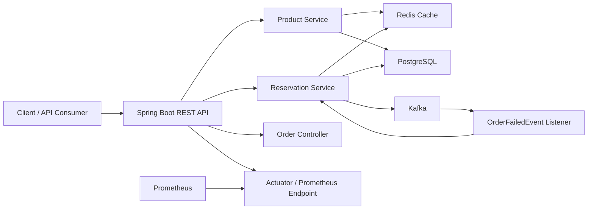

# Inventory Reservation System

A production-style backend service for reserving product inventory safely under concurrent traffic.

This project models a common e-commerce problem: many users may try to reserve the same product at the same time, but the system must never oversell stock. It uses Spring Boot, PostgreSQL row locking, Redis caching, Kafka events, idempotency keys, Prometheus metrics, structured logging, and automated tests.

## Why This Project Exists

In a real online store, product stock changes quickly. A user may reserve an item, confirm the order, cancel the order, retry the same request, or fail during payment. The backend must keep inventory numbers correct in all these cases.

This service handles that flow:

- A product has `totalStock`, `availableStock`, `reservedStock`, and `soldStock`.
- A reservation temporarily moves stock from available to reserved.
- A confirmation moves reserved stock to sold stock and creates an order.
- A release moves reserved stock back to available stock.
- Expired reservations are automatically released.
- Failed orders can release reservations through Kafka events.

The main rule is:

```text
totalStock = availableStock + reservedStock + soldStock
```

The application is designed to protect this rule even when many requests arrive at the same time.

## Tech Stack

| Area | Technology |
| --- | --- |
| Backend | Java 17, Spring Boot |
| API | Spring Web, Bean Validation, OpenAPI/Swagger |
| Database | PostgreSQL |
| Migrations | Flyway |
| ORM | Spring Data JPA, Hibernate |
| Cache | Redis, Spring Cache |
| Messaging | Apache Kafka |
| Observability | Spring Boot Actuator, Prometheus metrics, JSON logging |
| Testing | JUnit 5, Mockito, Testcontainers, Spring Boot integration tests |
| Load Testing | k6 |
| Local Infra | Docker Compose |

## Architecture



Simple explanation:

- The REST API receives product and reservation requests.
- PostgreSQL stores products, reservations, idempotency keys, and orders.
- Redis caches product lookups so repeated product reads do not always hit the database.
- Kafka is used for event-driven behavior, such as automatically releasing stock when an order fails.
- Prometheus can scrape metrics from the Actuator endpoint.

## Core Concepts Demonstrated

### 1. Safe Inventory Reservation

When a reservation is created, the service locks the product row in PostgreSQL before changing stock.

This prevents two users from reserving the same final unit of stock at the same time.

### 2. Idempotency

The `Idempotency-Key` header prevents duplicate reservations when a client retries the same request.

Example: if a mobile app sends the same reservation request twice because of a network retry, the backend returns the original reservation instead of reserving stock twice.

### 3. Event-Driven Release With Kafka

The service listens to the `order.failed` Kafka topic.

When an order failure event is received, the matching active reservation is released automatically.

This avoids tight coupling where another service must directly call:

```http
POST /reservations/{id}/release
```

### 4. Redis Caching

Product reads are cached in Redis.

When stock changes because of reserve, confirm, release, expiry, or Kafka order failure, the product cache entry is evicted so the next read returns fresh stock.

### 5. Observability

The service exposes:

- Health check: `GET /actuator/health`
- Prometheus metrics: `GET /actuator/prometheus`
- Structured JSON logs for production-friendly log search

### 6. Automated Testing

The project contains:

- Unit tests for service behavior
- Integration tests with real PostgreSQL using Testcontainers
- Concurrency tests to verify the system does not oversell

## API Overview

### Product APIs

| Method | Endpoint | Purpose |
| --- | --- | --- |
| `POST` | `/products` | Create a product |
| `GET` | `/products/{id}` | Get product stock details |

### Reservation APIs

| Method | Endpoint | Purpose |
| --- | --- | --- |
| `POST` | `/reservations` | Reserve stock |
| `GET` | `/reservations` | List reservations |
| `POST` | `/reservations/{id}/confirm` | Confirm reservation and create order |
| `POST` | `/reservations/{id}/release` | Release active reservation |

### Order APIs

| Method | Endpoint | Purpose |
| --- | --- | --- |
| `GET` | `/orders` | List created orders |

### Observability APIs

| Method | Endpoint | Purpose |
| --- | --- | --- |
| `GET` | `/actuator/health` | Check application health |
| `GET` | `/actuator/prometheus` | Expose Prometheus metrics |
| `GET` | `/swagger-ui.html` | Open Swagger UI |

## How To Run Locally

### Prerequisites

Install:

- Java 17
- Docker Desktop
- Git

You do not need to install Maven manually because the project includes the Maven Wrapper.

### 1. Clone the Repository

```bash
git clone https://github.com/Archit-k20/Inventory-Reservation-System.git
cd Inventory-Reservation-System
```

### 2. Start Infrastructure

```bash
docker compose up -d
```

This starts:

- PostgreSQL on port `5433`
- Redis on port `6379`
- Kafka on port `9092`

Check containers:

```bash
docker compose ps
```

### 3. Run the Application

On Windows:

```bash
.\mvnw.cmd spring-boot:run
```

On macOS/Linux:

```bash
./mvnw spring-boot:run
```

The app starts at:

```text
http://localhost:8080
```

### 4. Verify Health

```bash
curl http://localhost:8080/actuator/health
```

Expected result:

```json
{
  "status": "UP"
}
```

## Sample API Requests

The examples below use `curl`. On Windows PowerShell, you can also use Postman or Swagger UI at:

```text
http://localhost:8080/swagger-ui.html
```

### 1. Create a Product

```bash
curl -X POST http://localhost:8080/products \
  -H "Content-Type: application/json" \
  -d '{
    "sku": "IPHONE-15-BLACK",
    "name": "iPhone 15 Black",
    "totalStock": 10
  }'
```

Example response:

```json
{
  "id": "PRODUCT_ID",
  "sku": "IPHONE-15-BLACK",
  "name": "iPhone 15 Black",
  "totalStock": 10,
  "availableStock": 10,
  "reservedStock": 0,
  "soldStock": 0,
  "version": 0
}
```

Save the returned `id`. It is needed as `productId` in the next request.

### 2. Reserve Stock

```bash
curl -X POST http://localhost:8080/reservations \
  -H "Content-Type: application/json" \
  -H "Idempotency-Key: reserve-demo-001" \
  -d '{
    "productId": "PRODUCT_ID",
    "userId": "user-1",
    "quantity": 2
  }'
```

Example response:

```json
{
  "reservationId": "RESERVATION_ID",
  "productId": "PRODUCT_ID",
  "userId": "user-1",
  "quantity": 2,
  "status": "ACTIVE",
  "expiresAt": "2026-05-07T10:15:00Z"
}
```

Stock changes like this:

```text
availableStock: 10 -> 8
reservedStock: 0 -> 2
soldStock: 0
```

### 3. Retry Same Reservation With Same Idempotency Key

Run the same reservation request again with the same `Idempotency-Key`.

The service returns the same reservation instead of reserving stock again.

This is useful when clients retry requests after a timeout.

### 4. Confirm Reservation

```bash
curl -X POST http://localhost:8080/reservations/RESERVATION_ID/confirm
```

Example response:

```json
{
  "reservationId": "RESERVATION_ID",
  "orderId": "ORDER_ID",
  "status": "CONFIRMED"
}
```

Stock changes like this:

```text
availableStock: 8
reservedStock: 2 -> 0
soldStock: 0 -> 2
```

### 5. Release Reservation

Use this for an active reservation that should be cancelled.

```bash
curl -X POST http://localhost:8080/reservations/RESERVATION_ID/release
```

Stock changes like this:

```text
availableStock increases
reservedStock decreases
soldStock stays the same
```

## Kafka Order Failure Flow

This project supports an event-driven release flow.

Scenario:

1. User reserves stock.
2. Another service, such as an Order Service, fails payment.
3. That service publishes an event to Kafka topic `order.failed`.
4. Inventory service consumes the event.
5. Inventory service releases the active reservation.

Kafka event shape:

```json
{
  "reservationId": "RESERVATION_ID",
  "reason": "payment_failed"
}
```

Send a test event using Docker:

```bash
echo '{"reservationId":"RESERVATION_ID","reason":"payment_failed"}' | docker run --rm -i --network inventory-system_default apache/kafka:3.9.0 /opt/kafka/bin/kafka-console-producer.sh --bootstrap-server kafka:9093 --topic order.failed
```

Then check the product again:

```bash
curl http://localhost:8080/products/PRODUCT_ID
```

Expected result:

```text
availableStock increases
reservedStock becomes lower
```

Simple explanation:

The Inventory service does not need another service to directly call its release API. It reacts to an event and updates stock by itself.

## Running Tests

### Unit Tests

```bash
.\mvnw.cmd test
```

On macOS/Linux:

```bash
./mvnw test
```

### Integration Tests

Docker Desktop must be running.

```bash
.\mvnw.cmd verify -Pintegration
```

On macOS/Linux:

```bash
./mvnw verify -Pintegration
```

These tests use Testcontainers to start a real PostgreSQL database for integration testing.

## Load Testing

The project includes a k6 script:

```text
load-tests/reserve.js
```

Before running it, create a product and replace the `productId` inside the script with a valid product ID.

Run:

```bash
k6 run load-tests/reserve.js
```

The test simulates concurrent reservation traffic and checks response times and failure rate.

## Important Local Configuration

The local Docker database credentials are:

```text
Database: inventory_db
Username: postgres
Password: postgres
Port: 5433
```

These are local development credentials only. In a real deployment, they should be moved to environment variables or a secret manager.

## What This Project Demonstrates

This project demonstrates backend engineering skills that are more advanced than simple CRUD:

- Designing REST APIs for product, reservation, and order workflows
- Handling concurrent stock updates without overselling
- Using database row locks for consistency
- Implementing idempotency for safe client retries
- Using Redis caching while keeping cached data fresh after writes
- Using Kafka for event-driven communication between services
- Managing database schema changes with Flyway
- Adding production-style observability with Actuator, Prometheus metrics, and JSON logs
- Writing unit, integration, and concurrency tests
- Running infrastructure locally with Docker Compose

## Resume Bullet Points

You can adapt these directly for your resume:

- Built a Spring Boot inventory reservation backend with PostgreSQL, Redis, Kafka, Flyway, and Docker Compose.
- Implemented concurrency-safe stock reservation using PostgreSQL pessimistic row locking to prevent overselling under high traffic.
- Added idempotency-key support to make reservation retries safe and avoid duplicate stock deductions.
- Integrated Redis caching for product reads with cache eviction after reservation, confirmation, release, and expiry flows.
- Implemented Kafka-based event-driven reservation release for failed orders.
- Added Prometheus metrics, JSON structured logging, unit tests, integration tests, and concurrency tests using Testcontainers.

## Future Improvements

Possible next improvements:

- Add OpenTelemetry and Jaeger for distributed tracing
- Add authentication and role-based access control
- Add CI pipeline with GitHub Actions
- Add a small dashboard for inventory and reservation monitoring

